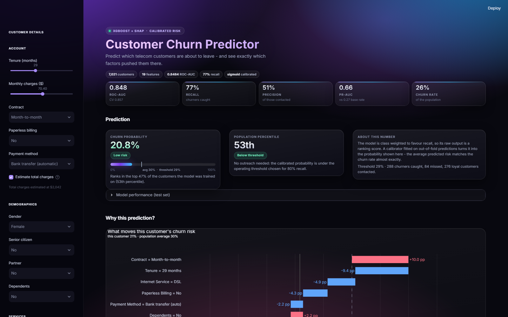
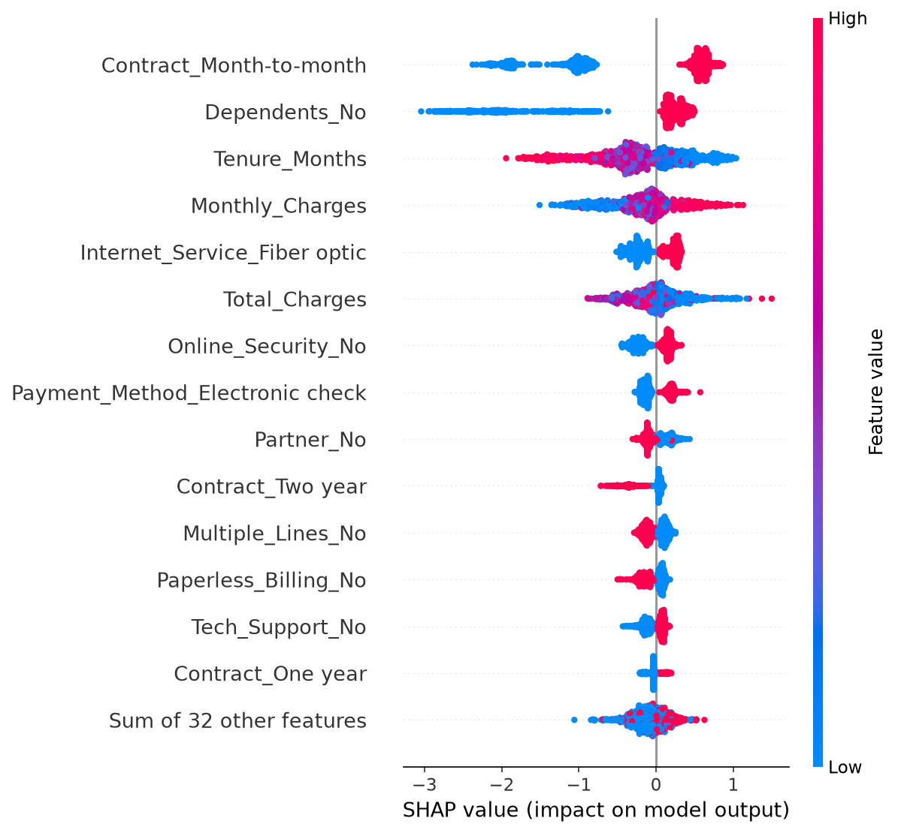

# 📉 Customer Churn Predictor

An end-to-end machine learning project that predicts which telecom customers are likely to cancel, and explains *why* using SHAP.

**🔗 Live demo:**  https://sl-churn-predictor.streamlit.app/



## Problem

Acquiring a new customer costs far more than keeping an existing one. This project predicts churn risk from account, demographic and service data so a retention team can focus on the customers most likely to leave.

## Dataset

IBM Telco Customer Churn dataset (7,043 customers, 26.5% churn rate).

**Data leakage handling:** the raw file includes `Churn Label`, `Churn Value`, `Churn Score`, `CLTV` and `Churn Reason`. These are only known after a customer has churned (or are derived from churn), so I removed them from the features. Location and ID columns were also dropped.

**Duplicate observations:** dropping `CustomerID` leaves 22 rows that are byte-for-byte identical. They are removed before splitting so the same observation can never appear in both the train and the test split.

## Approach

1. **EDA:** examined churn rates across contract type, internet service and payment method.
2. **Preprocessing:** scikit-learn `Pipeline` with scaling for numeric features and one-hot encoding for categorical ones, fit on training data only to avoid leakage.
3. **Model selection:** 5-fold stratified cross-validation **on the training split only**. The test split is scored exactly once, at the very end.
4. **Calibration:** the class-weighted model outputs a ranking score, not a probability. A calibrator fitted on out-of-fold predictions turns it into a real churn probability.
5. **Operating point:** the decision threshold is chosen on training data for a target recall of 80%, then applied unchanged to the test set.
6. **Explainability:** SHAP values aggregated back from the 46 encoded columns to the 19 raw features, shown as a waterfall in probability points.
7. **Deployment:** Streamlit app that shows the calibrated risk, the population percentile and a SHAP waterfall chart for each prediction. The charts are Plotly rather than Matplotlib, so they re-lay out instead of being scaled down to a few pixels on a narrow screen.
8. **Interface:** a dark "aurora" dashboard - a multi-colour gradient mesh behind the page, frosted glass cards floating on top of it, a gradient display title with a slow shimmer, and a glowing risk meter that marks the retention threshold. The theme lives in [`.streamlit/config.toml`](.streamlit/config.toml) and the components in [`src/theme.py`](src/theme.py).

## Results

Model comparison, 5-fold CV on the **training split**:

| Model | CV ROC-AUC |
|---|---|
| Logistic Regression | 0.8591 ± 0.0154 |
| Random Forest | 0.8629 ± 0.0153 |
| **XGBoost** | 0.8572 ± 0.0168 |

All three land within one standard error of each other, so the differences are noise. The **one-standard-error rule** applies: the winner is decided on the app's requirements (fast exact TreeSHAP, small artifact) rather than on a 0.006 difference the data cannot support.

Final model, scored **once** on the held-out test split (1,405 rows, 26.5% churn):

| Metric | Value |
|---|---|
| ROC-AUC | 0.848 |
| PR-AUC | 0.656 |
| Precision | 0.511 |
| Recall | 0.774 |
| F1 | 0.615 |
| Brier score | 0.136 |

At the 29% operating point: **288 churners caught, 84 missed**, 276 loyal customers contacted unnecessarily.

The project optimises for **recall** (~77%): for retention, missing a churner usually costs more than contacting a loyal customer. The trade-off is lower precision (~51%).

### Calibration

Class weighting means the raw model output cannot be read as a probability - it predicted an average risk of 38.6% against a true churn rate of 26.5%. Fitting a **sigmoid (Platt) calibrator** on out-of-fold predictions (chosen over isotonic by cross-validated log loss, 0.401 vs 0.421) closes the gap:

| | Mean predicted | Actual base rate | Gap |
|---|---|---|---|
| Raw model output | 0.386 | 0.265 | **+0.121** |
| Calibrated | 0.266 | 0.265 | **+0.001** |

The app shows the calibrated probability, so "40%" means a genuine 40% chance of churning.

## Key insights

- **Contract type:** month-to-month customers churn at 42.7%, versus 2.8% for two-year contracts.
- **Internet service:** fiber optic customers churn at 41.9%, more than double DSL (19.0%).
- **Payment method:** electronic check users churn at 45.3%, versus 15–17% for automatic payments.
- SHAP confirms the same drivers: short tenure, high monthly charges, and no tech support or online security increase risk.



**Suggested actions:** offer discounts for annual contracts, bundle security and support for new fiber customers, and encourage automatic payments.

## Limitations

- The dataset is a static sample with no time dimension, so the model can't capture changing behaviour.
- `Total Charges` is estimated as tenure × monthly charges unless the real value is entered in the app. The estimate shifts the score for roughly 1% of customers by enough to change their risk band.
- The model is trained on one dataset and is not validated on a second one, so the reported numbers are an optimistic estimate of real-world performance.
- SHAP attributions are computed on the underlying ranking model; the chart converts them to probability points, but the ordering of the factors depends on the order they are applied.

## Run locally

```bash
git clone https://github.com/rkkl1511/churn-predictor.git
cd churn-predictor
python -m venv venv
venv\Scripts\activate        # Mac/Linux: source venv/bin/activate
pip install -r requirements.txt
streamlit run app.py
```

To retrain the model and regenerate the artifacts:

```bash
python src/train.py
```

To run the test suite (34 tests covering the artifacts, the calibration, the SHAP aggregation, the charts, the theme and the app itself):

```bash
pytest tests
```

## Project structure

```
├── app.py                    # Streamlit app
├── .streamlit/config.toml    # Theme: colours, fonts, dark sidebar
├── src/
│   ├── train.py              # Reproducible training pipeline
│   ├── predictor.py          # Scoring + SHAP logic (no Streamlit, so it is testable)
│   ├── charts.py             # Plotly figures
│   └── theme.py              # CSS and HTML components (aurora hero, KPI cards, risk meter)
├── notebooks/                # EDA and modelling narrative
├── models/                   # pipeline, calibrator and metadata
├── data/                     # raw, cleaned and modelling datasets
├── images/                   # Plots used in this README
├── scripts/                  # Notebook builder and screenshot helper
├── tests/                    # pytest suite
├── pytest.ini
└── requirements.txt
```

## Tech stack

Python, pandas, scikit-learn, XGBoost, SHAP, Streamlit, Plotly, pytest
