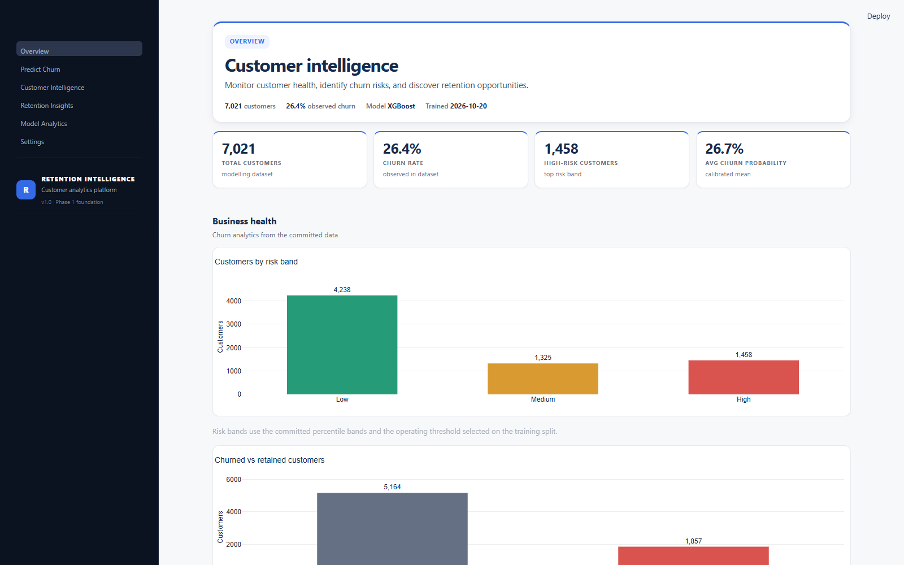
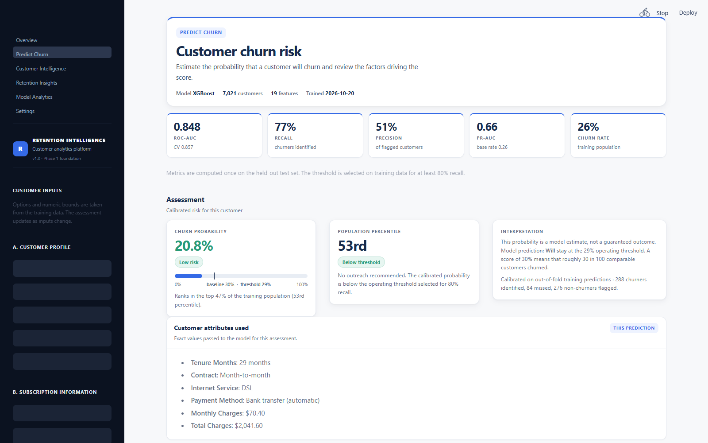
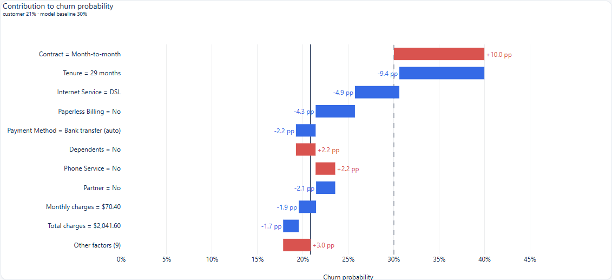
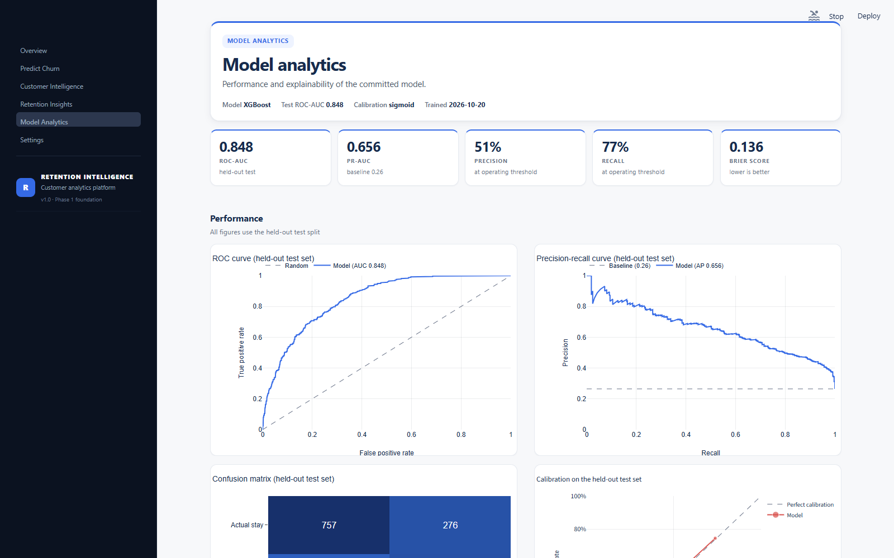
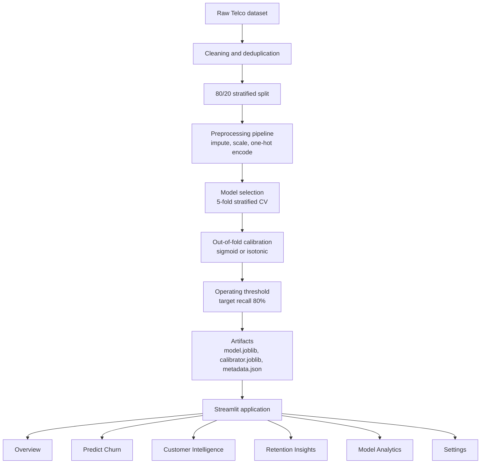

# Retention Intelligence

**Customer analytics and churn prediction platform**

[](https://github.com/basanta-codexa/churn-predictor/actions/workflows/ci.yml)
[](https://www.python.org/)
[](https://streamlit.io/)
[](LICENSE)
[](https://sl-churn-predictor.streamlit.app/)

## Contents

- [Hero](#retention-intelligence)
- [2. Product preview](#2-product-preview)
- [3. Overview](#3-overview)
- [4. Key features](#4-key-features)
- [5. Performance](#5-performance)
- [6. Architecture](#6-architecture)
- [7. Tech stack](#7-tech-stack)
- [8. Project structure](#8-project-structure)
- [9. Installation](#9-installation)
- [10. Usage](#10-usage)
- [11. Model explainability](#11-model-explainability)
- [12. Deployment](#12-deployment)
- [13. Limitations](#13-limitations)
- [14. Roadmap](#14-roadmap)
- [15. Contributing](#15-contributing)
- [16. License](#16-license)

## 2. Product preview

Screenshots captured from the running application on 20 November 2026.

<p align="center">
  
  
</p>

<p align="center">
  
  
</p>

## 3. Overview

Retention Intelligence estimates the probability that a telecom customer will churn and explains the factors behind the score. It is built around a reproducible scikit-learn/XGBoost pipeline and a six-page Streamlit application.

The platform covers:

- business-level churn analytics for the full customer base;
- individual customer assessment with a calibrated probability;
- SHAP-based explanations at both individual and aggregate level;
- a searchable customer directory with batch CSV prediction;
- model performance and calibration analysis;
- read-only configuration and data export.

This is a demonstration project. The reported metrics come from one held-out split of a public dataset and do not guarantee production performance.

## 4. Key features

- **Calibrated prediction** — the class-weighted XGBoost score is mapped to a churn probability with a sigmoid calibrator fitted on out-of-fold predictions.
- **Individual assessment** — grouped customer inputs, a risk band, a population percentile, and a clear model verdict at the operating threshold.
- **SHAP explainability** — one-hot columns are aggregated back to the 19 raw features and shown as probability-point contributions and log-odds attributions.
- **Overview analytics** — real KPIs, risk distribution, churn by contract, payment method, tenure, and calibrated probability.
- **Customer intelligence** — search, filtering, risk ranking, pagination, validated batch CSV upload, and downloadable predictions.
- **Retention insights** — risk segmentation, aggregated SHAP drivers, and cohort guidance with an explicit causal caveat.
- **Model analytics** — ROC and precision-recall curves, confusion matrix, calibration curve, global feature importance, and stored model information.

## 5. Performance

Held-out test split: **1,405 rows**, **26.5% churn**. The split was scored once after model selection, calibration, and threshold selection were complete.

| Metric | Result |
|---|---:|
| ROC-AUC | 0.848 |
| PR-AUC | 0.656 |
| Recall | 77.4% |
| Brier score | 0.136 |

Supporting values: precision 51.1%, F1 0.615, accuracy 74.4%, log loss 0.408. The operating threshold is 29.4%, selected on training data for a target recall of 80%. These are test-set results, not production performance guarantees.

## 6. Architecture



## 7. Tech stack

| Layer | Tools |
|---|---|
| Application | Streamlit, custom CSS, Plotly |
| Machine learning | scikit-learn, XGBoost |
| Explainability | SHAP |
| Data | pandas, NumPy |
| Artifacts | Joblib, JSON metadata |
| Testing | pytest |
| Deployment | Streamlit Community Cloud |

## 8. Project structure

```text
.
├── app.py                     # Streamlit router and page registration
├── .streamlit/config.toml     # Theme configuration
├── pages/                     # Named application pages
│   ├── 1_Overview.py
│   ├── 2_Predict_Churn.py
│   ├── 3_Customer_Intelligence.py
│   ├── 4_Retention_Insights.py
│   ├── 5_Model_Analytics.py
│   └── 6_Settings.py
├── src/
│   ├── design.py              # Design tokens and reusable components
│   ├── page_shell.py          # Shared page setup
│   ├── theme.py               # CSS and HTML components
│   ├── data_loader.py         # Real customer data and scoring helpers
│   ├── explainability.py      # Aggregated SHAP summaries
│   ├── train.py               # Training, selection, calibration, evaluation
│   ├── predictor.py           # Scoring and SHAP logic
│   └── charts.py              # Plotly figures
├── tests/                     # pytest suite
├── docs/                      # Deployment documentation
├── scripts/                   # Notebook helper
├── notebooks/                 # Exploratory analysis
├── models/                    # Model, calibrator, and metadata
├── data/                      # Raw, cleaned, and modelling datasets
├── images/                    # README screenshots and figures
├── CONTRIBUTING.md
├── LICENSE
├── README.md
├── pytest.ini
└── requirements.txt
```

## 9. Installation

```bash
git clone https://github.com/basanta-codexa/churn-predictor.git
cd churn-predictor
python -m venv venv
venv\Scripts\activate        # macOS/Linux: source venv/bin/activate
pip install -r requirements.txt
streamlit run app.py
```

Open the URL printed by Streamlit, usually `http://localhost:8501`.

## 10. Usage

### Individual prediction

1. Open **Predict Churn** from the sidebar.
2. Enter customer details in the grouped form.
3. Read the calibrated probability, risk classification, population percentile, and customer attributes used.
4. Expand **Risk drivers** or **SHAP attribution** for the explanation.

The probability is a model estimate, not a guaranteed outcome.

### Batch prediction

1. Open **Customer Intelligence**.
2. Upload a CSV whose columns match `feature_order` in `models/metadata.json`. Raw column names with spaces are normalised to underscores.
3. The app validates required columns, reports missing values, and limits files to 10,000 rows.
4. Download the scored result as `churn_predictions.csv`.

### Retraining and tests

```bash
python src/train.py
pytest tests
```

Retraining rewrites the artifacts in `models/` and the modelling dataset in `data/`. Do not retrain for documentation or styling changes.

## 11. Model explainability

The XGBoost model is class-weighted, so its raw output is a ranking score rather than a probability. A sigmoid calibrator fitted on out-of-fold predictions maps that score to a churn probability. The operating threshold is then selected on out-of-fold calibrated training predictions for a target recall of 80%.

SHAP values are computed with `TreeExplainer`. The app aggregates the 46 one-hot encoded columns back to the 19 raw features. Individual explanations are shown as probability-point contributions; global explanations average the same SHAP values across a deterministic 300-customer sample.

SHAP values describe associations learned by the model, not proven causes. Retention actions should be validated experimentally.

## 12. Deployment

The application is deployed on Streamlit Community Cloud and rebuilds from `main` on every push. See [`docs/DEPLOYMENT.md`](docs/DEPLOYMENT.md) for the pre-deployment checklist, local verification steps, and current production limitations.

A public demo is live at <https://sl-churn-predictor.streamlit.app/>. Authentication, audit logging, and production monitoring are not implemented.

## 13. Limitations

- The dataset is a static public sample with no time dimension, so behavioural drift is not captured.
- The model has not been validated on external or temporal data.
- `Total Charges` is estimated as tenure multiplied by monthly charges unless the actual value is entered.
- SHAP values are associative, not causal.
- Subgroup fairness has not been audited.
- The application has no authentication, audit logging, drift monitoring, or model rollback.

## 14. Roadmap

| Status | Item |
|---|---|
| Completed | Premium light UI and six-page navigation |
| Completed | Overview analytics and KPI dashboard |
| Completed | Individual prediction with calibrated probability and SHAP |
| Completed | Customer directory, search, filters, ranking, and batch CSV prediction |
| Completed | Retention insights with aggregated SHAP drivers |
| Completed | Model analytics with ROC, PR, confusion matrix, and calibration |
| Completed | Public Streamlit Cloud demo and CI test suite |
| Completed | Real README screenshots, MIT license, and contribution guidelines |
| Planned | Authentication and authorization |
| Planned | Audit logging and access controls |
| Planned | Drift monitoring and scheduled retraining |
| Planned | External and temporal validation |
| Planned | Fairness audit across protected attributes |
| Planned | Production deployment with rollback and monitoring |

## 15. Contributing

See [`CONTRIBUTING.md`](CONTRIBUTING.md) for setup, checks, and pull-request guidelines. Please keep changes focused, preserve the calibrated prediction pipeline, and update screenshots when the UI changes.

## 16. License

This project is licensed under the [MIT License](LICENSE).

The IBM Telco Customer Churn dataset is a public sample. Refer to its original distribution terms for licensing and attribution.
